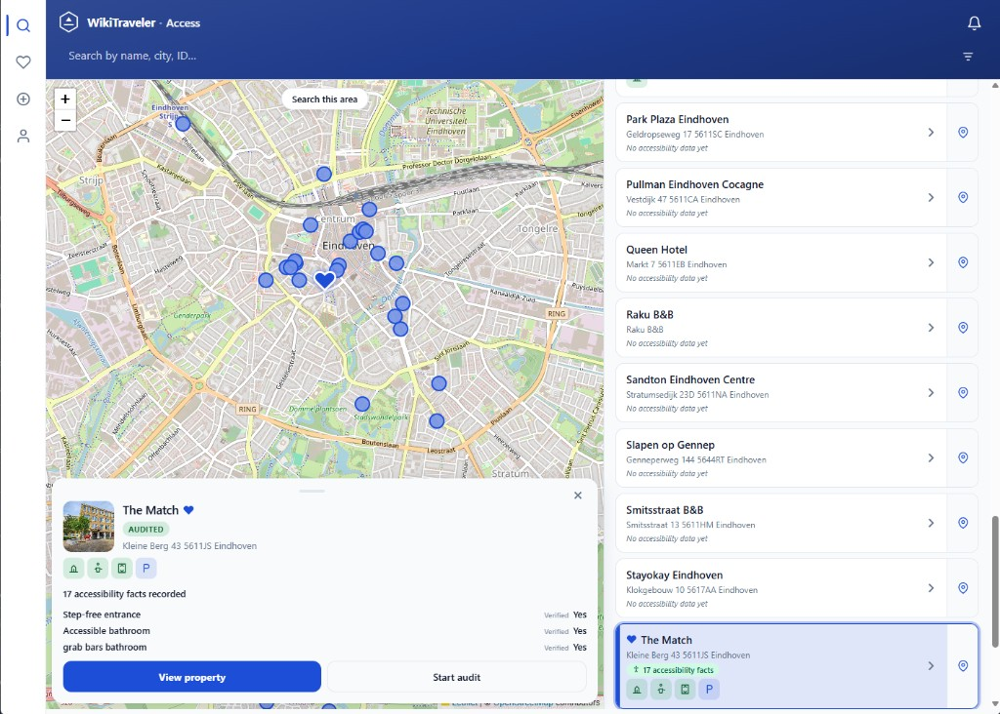
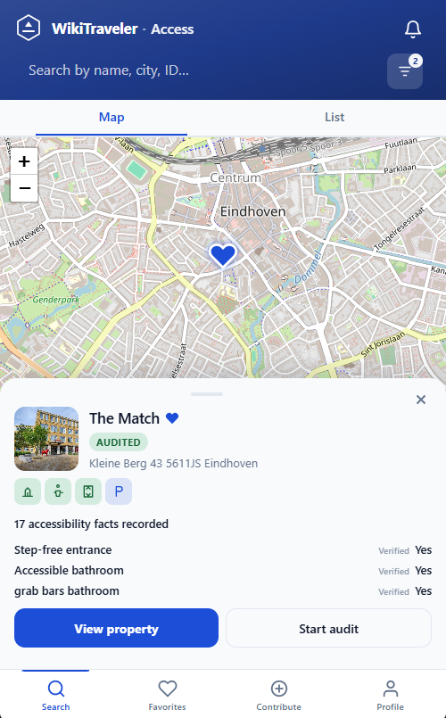
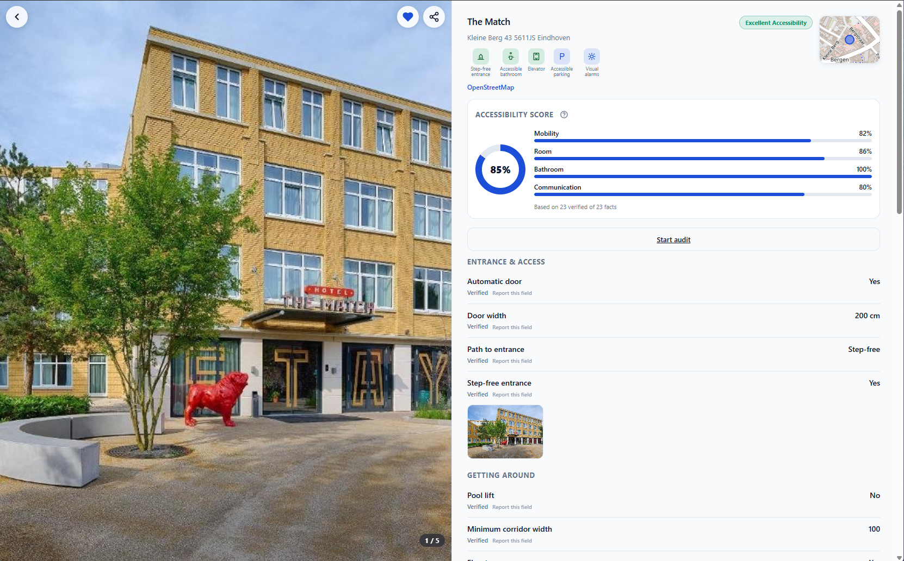
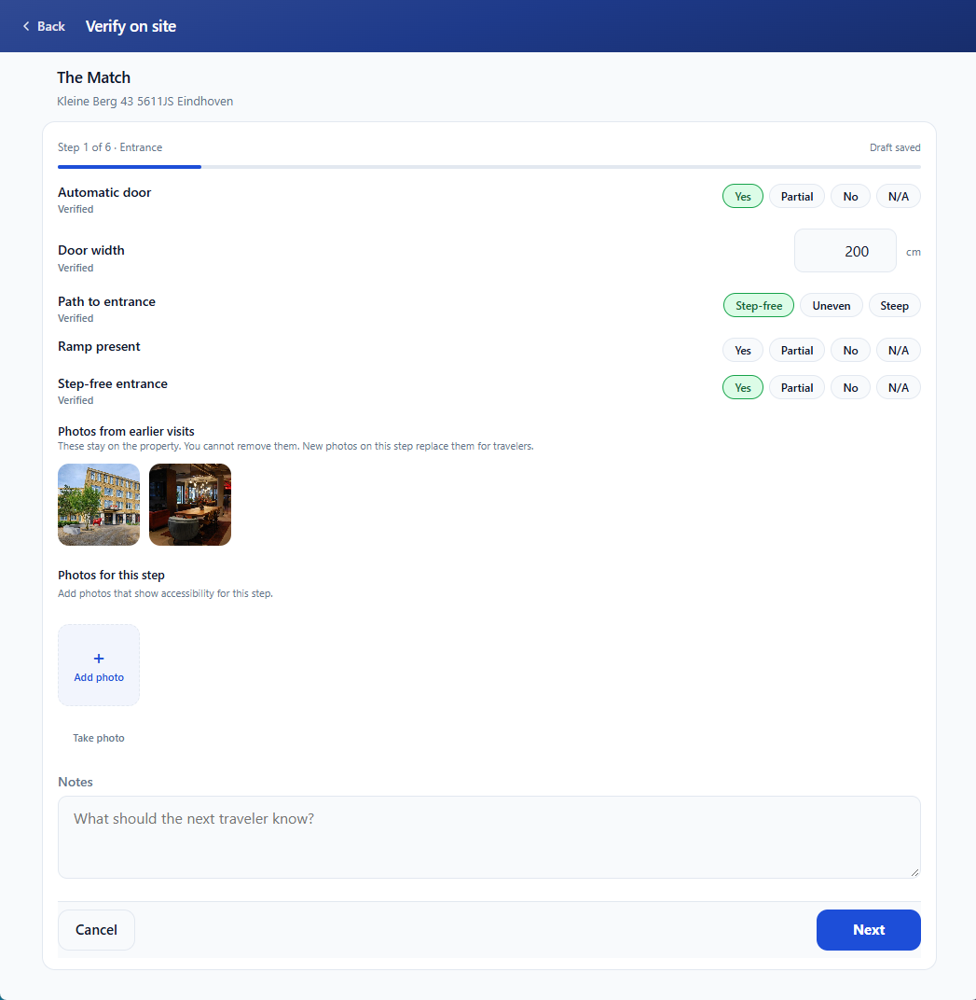
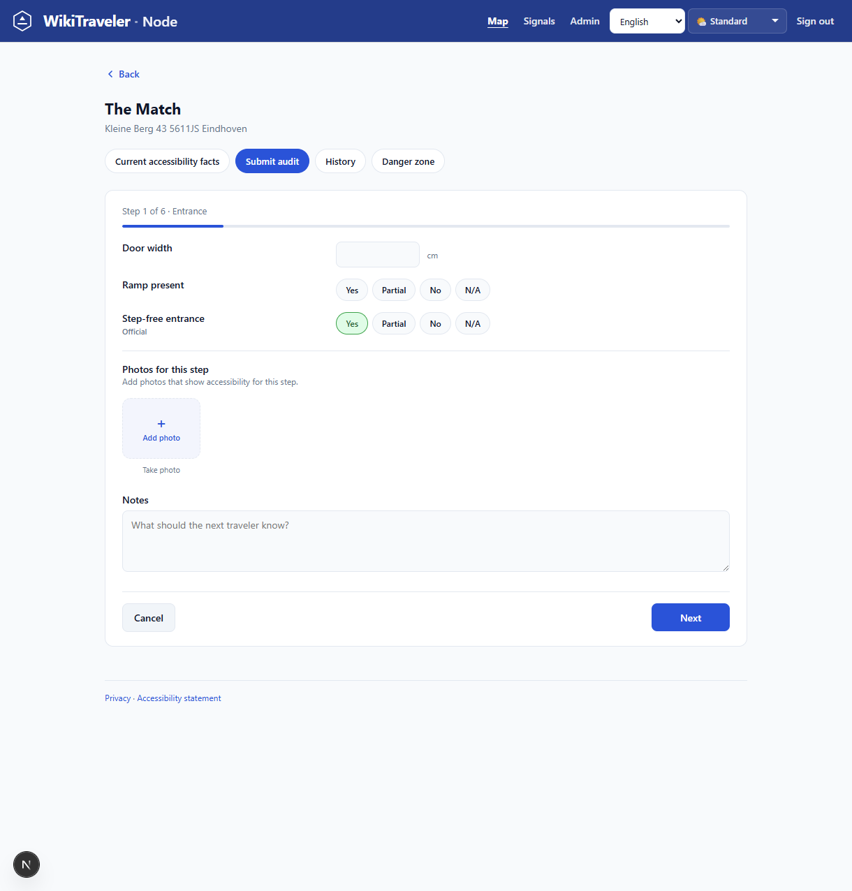
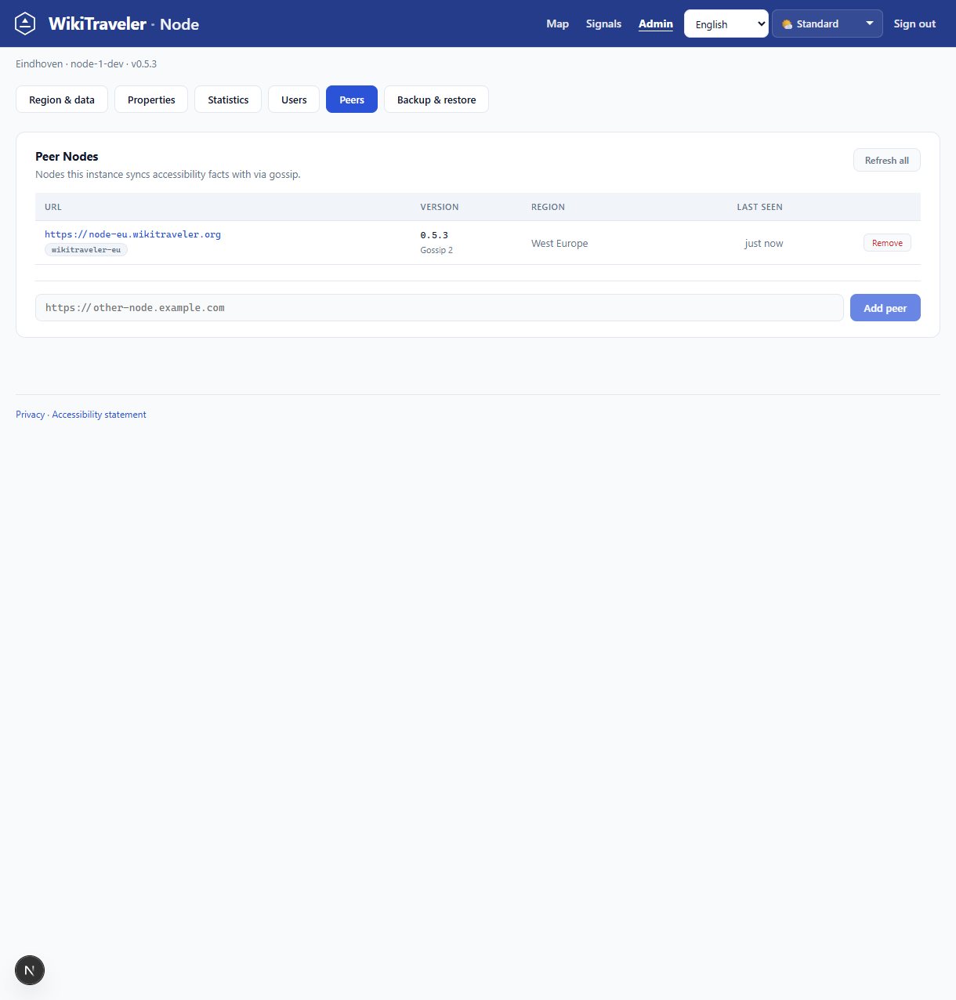
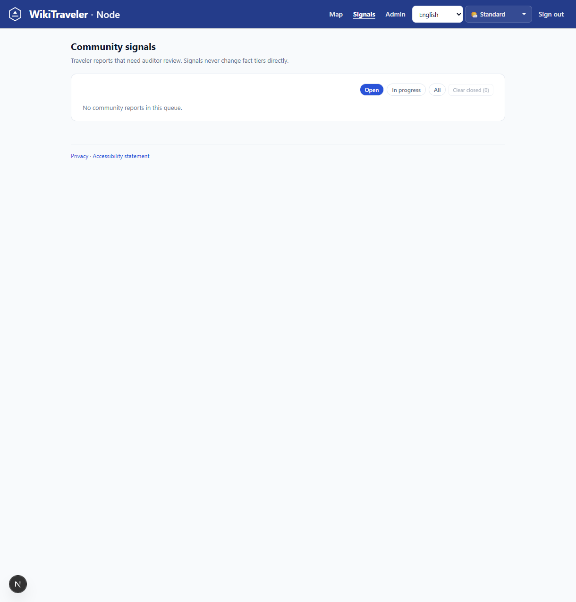
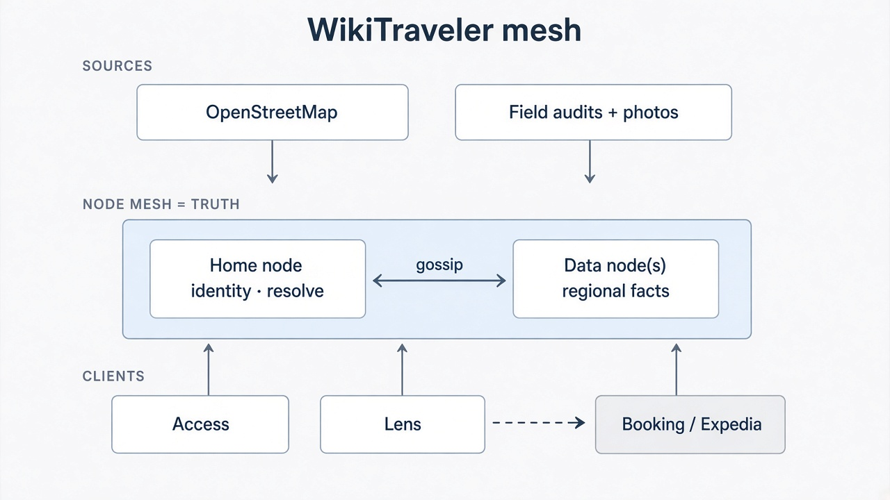
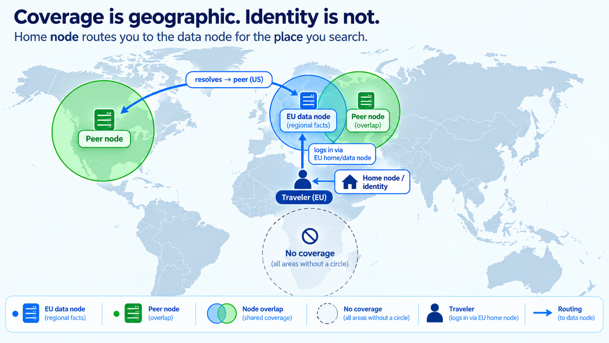

> **Not the live site source.** The published story is the React page at [`apps/www/app/story/`](../../apps/www/app/story/) ([www.wikitraveler.org/story](https://www.wikitraveler.org/story)). This markdown is an editorial archive for paste/export only.

# The hotel said “accessible.” That wasn’t enough.

### A relative told me how miserable booking travel with a wheelchair still is. Curiosity and a UX brain did the rest, then I got sucked into an accidental product once coding stopped being the bottleneck.

---

I didn’t set out to build infrastructure.

I set out to answer a relatively human question that somehow never gets a trustworthy answer when you need it most:

**Is this hotel actually accessible, not “accessible according to a marketing checkbox,” but accessible according to someone who has been there, looked, measured, photographed, and cared?**

That question came from Maurice.

Maurice is my cousin-in-law. He uses a wheelchair. We talked at the funeral of my uncle Jaap. The kind of conversation that sits between grief and ordinary life, where people suddenly tell you the real stuff: booking travel is exhausting when accessibility information is missing, outdated, contradictory, or written by someone who has never pushed a chair through a bathroom doorway.

When a UX engineer hears a problem like that, the head does overtime. You don’t live that life. You still have to stand in those shoes long enough to feel the booking flow break: sitting with the tab open, in the chair. Will the entrance actually work? Is the “accessible” room reachable when the lift isn’t? Can you turn in the bathroom, or do you find out the sink blocks the transfer only after you’ve paid and traveled? Search says accessible. The photo omits the doorway. A review says “wheelchair-friendly” like “cozy”, atmosphere, not evidence. Too often: *you won’t know until you’re there.*

When people struggle like that, the system is often lying about complexity. It pretends the workflow is simple. It hides the missing data. It optimizes for the median user and calls the rest an edge case.

Accessibility information for hotels, apartments, and other stays is not an edge case. It’s a trust problem dressed up as a content problem.

That picture has to come first. Only then do the product and engineering questions get real room, what scales without lying, what’s feasible to build without up-to-date programming knowledge.

Strong AI models change the tempo: they can implement against a picture you can already hold in your head. The picture is the hard part. The agents type. You’re the conductor.

So I did what people with dangerous curiosity always do.

I started building.

First the data model. Then the sidecar. Then the mesh. Then the parts that make a side project start behaving like an accidental product.

And then it got out of hand, in the useful way.

Welcome to WikiTraveler.

This piece is mainly for people who do **UX and product work** and are figuring out what AI-assisted building changes, and what it doesn’t.  
Along the way it should also make sense if you care about **disability and travel access**, **open source commons**, or **shipping weird infrastructure as a side project**.

Different readers can take different exits. Same story.

One vocabulary note before we go on, because “UX” gets abused into meaning “someone made the buttons blue.” **User experience (UX)** is the whole lived path through a product: goals, confusion, trust, dead ends, what happens when the data is wrong. **Usability** is a chunk of that, can someone complete the task without fighting the interface? **UI** is the visible layer: screens, controls, layout. Related; not the same. Product sense asks whether we’re solving the right problem at all. When I say UX in this piece, I mostly mean the *experience of trusting a stay*, journey and information architecture first, pixels second.

---

## Confession: I am not a full-time distributed-systems engineer

I do UX and engineering for work.

That means I spend a lot of time on how complex tools feel to real people: flows, information structure, trust, whether something is usable under pressure, usability inside a broader experience, with UI as one of the instruments.

I can prototype. I’m not allergic to code. My programming knowledge is uneven and, in places, outdated. Historically that would have been enough to stop a build like this. Today I build with AI assistance across several projects, not because the model should own the product, but because I can now ship things like:

- a federated mesh of nodes
- gossip sync
- RS256 cross-node auth
- OSM ingest
- an audit PWA
- a Chrome extension
- an agency SDK
- Docker + Vercel deployment paths
- release compatibility policy
- SSRF hardening
- and a community model with auditors and operators

…in six months, as a side project.

Which is exactly what happened.

**The scarce skill is picturing the whole system as experience, as architecture, and as a value bet, and keeping those views coherent.**

AI doesn’t invent that picture.
AI doesn’t invent taste.
AI doesn’t invent the original problem. Maurice did.

What it offers is **hands at the tempo of thought**. Multiple agents assemble parts. You argue via diffs, check they aren’t solving the wrong problem, and kill that path before it hardens.

Throughput, it turns out, is a hell of a drug.

---

## The March 2026 manifesto (mostly still true)

On **18 March 2026**, early in the build, I wrote myself a manifesto. It had a version number. It had emoji. It had sentences like “Distributed Truth Layer” and “Community-Owned Certainty.” It was earnest, a little loud, and looking back, almost awkwardly on target.

The vision, compressed:

> Replace unreliable corporate booking data with a community-driven truth layer. Travelers deserve certainty, not best guesses. Keep insights free, open, and verified by people on the ground, not by whoever is selling the room.

The strategy had five verbs: **Expose → Verify → Decentralize → Gossip → Open-source.**

The toolkit was already named in spirit: **Node**, **Lens**, **Field Kit**, a **gossip** sync, trust tiers from official baseline → AI guess → community verification → multi-party consensus.

What held:

- sidecar, not replacement
- AI estimates guide; they don’t become reality
- field audits as the scarce honest resource
- federated nodes so truth can’t sit behind one paywall
- Lens as the browser overlay
- open protocol / open data instincts (MIT code, CC-BY mesh data)

---

## What WikiTraveler is (today)

WikiTraveler is an open-source toolkit for **federated accessibility intelligence for travel**.

In human terms:

- **Nodes** hold the truth for geographic regions.
- **Access** is the traveler/auditor web app.
- **Lens** is the [Chrome extension](https://chromewebstore.google.com/detail/wikitraveler-lens/bkkbidghpfkojnhhjnmddegkiopjbkho) that injects community facts into booking sites.
- **SDK** ([@wikitraveler/sdk](https://www.npmjs.com/package/@wikitraveler/sdk)) lets agencies and travel products embed or fetch the same data.
- **Core** shared packages define tiers, merge rules, and gossip logic.

Trust is layered on purpose:

| Tier        | Meaning                                               |
| ----------- | ----------------------------------------------------- |
| `OFFICIAL`  | Baseline from OSM / Wikidata-style sources            |
| `AI_GUESS`  | Machine estimate to guide auditors, not ground truth |
| `VERIFIED`  | A field audit happened                                |
| `CONFIRMED` | Multiple independent auditors agree                   |

Higher tiers win on merge.

That one table is the moral of the system.

### What it looks like

Same trust model, different jobs, search, detail, field audit, booking sidecar, and operating a node.
(Canonical layout: React page on www.)

**Access: find a stay**

*Search on desktop and mobile. Scores and facts in these screenshots are made up for illustration, not real property data.*

**Access: property detail**

*Detail is where travelers see evidence, not a marketing checkbox. Scores and facts in this screenshot are made up for illustration, not real property data.*

**Access: audit wizard**

*Field proof attaches to the claim, not a free-floating tag. Values and photos in this screenshot are made up for illustration, not a real audit.*

**Lens: booking sidecar**

*Sidecar UX: stay where people already book. Scores and facts in this screenshot are made up for illustration, not real property data.*

**Node Admin: operate a region**

*Edit audits on a stay, sync peers over gossip, review traveler signals. Property facts in these screenshots are made up for illustration, not real audits.*

---

## System overview (the napkin version)

The full architecture doc is longer. The useful mental model is short:

**Clients never hold the truth. Regional nodes do, and they gossip.**

*Sources feed the mesh. The mesh is the truth. Clients only ask.*

OpenStreetMap is the baseline. People add audits and photos. That truth lives on **nodes**: same software everywhere. Nodes **gossip** so no single server covers the planet. Access, Lens, and the SDK only ask the mesh; they never become the source of record.

*Coverage is geographic. Identity is not. A traveler signed in on an EU node can still look up a hotel in the US: their node routes them to the peer that covers that region. Some coverages overlap; others don’t.*

---

## Sidecar, not destination

This is the UX idea I care about most.

People do not wake up wanting a new travel platform.
They wake up wanting a stay that won’t trap them.

So WikiTraveler is designed as a **sidecar**:

1. **Baseline from the commons**: OpenStreetMap and related open sources give you something to start from.
2. **Truth lives in a mesh**: independent nodes gossip verified facts; no single vendor is required.
3. **Clients consume the mesh**: Access, Lens, SDK.
4. **Existing platforms remain the booking surface**: we overlay, enrich, deep-link, report issues.

Lens is the purest expression of that idea.

You’re on Booking.com / Expedia / Hotels.com.
You hover a listing.
WikiTraveler tries to resolve the property and show accessibility facts from the community mesh.
If the area isn’t covered, it should say so honestly instead of inventing confidence.

The [SDK](https://www.npmjs.com/package/@wikitraveler/sdk) is the same idea for product teams:

> Don’t rebuild accessibility truth.
> Consume the commons.
> Show it in *your* UX.

Ambitious, and still early. Yet the bet is simple: an open mesh of field-checked facts is more useful than another closed database of half-true icons.

---

## How the system was built (in acts)

I won’t pretend this arrived fully formed. It grew in layers, each one solving a real problem, and sometimes creating the next one.

### Act I: Inventory without renting the universe

First problem: where do the stays come from?

The March 2026 manifesto still assumed **Amadeus** as the official baseline to “expose” vague corporate tags. I started there because it looked like a sensible property feed. Then the self-service developer portal was gone: decommissioned on **17 July 2026** (their announcement), with only the Enterprise API path remaining, request access, sandbox, travel consultants, commercial offers. For a side project that wants open, keepable inventory, that’s a dead end. So I ripped the dependency out and went looking for a baseline I could keep building on without a sales conversation every time the wind changed.

That search landed on **OpenStreetMap** (plus related open sources like Wheelmap ideas early on).

OSM didn’t just replace a feed. It pushed the product toward commons thinking:

- start from open map data
- enrich with people who actually visit
- distribute the result
- ride beside booking platforms instead of becoming one
- eventually give **coarse** verified wheelchair signals back to OSM where they belong, and keep stay-depth (photos, measurements, trust tiers) in WikiTraveler

Around the same time I sketched the first **Lens** idea (show facts on top of existing sites) and poked at federation experiments that didn’t all survive. The important leftover: **the data layer should be open and ownable**: and neighbourly to the commons it already leans on, not a one-way extract.

### Act II: One node isn’t a world

Second problem: a single server can’t honestly cover the planet, and a central “node registry” is still a soft monopoly.

So the system grew a **mesh**:

- every operator runs the same **node** software (identity, regional facts, or both)
- clients ask “which node is responsible for here?”
- nodes **gossip** deltas to peers
- bootstrap peers help a new node find the network

I did try the obvious shortcut first: a central registry. It felt orderly. It was also the wrong shape for a commons. Killing it forced the real design: peer discovery, geographic resolve, and federation that doesn’t need a king.

### Act III: Make it usable for travelers and auditors

Third problem: infrastructure without a product is a science fair.

The traveler/auditor app started life as **Field Kit**: a name that sounded like specialist gear. The product needed to serve travelers *and* people doing audits. Renaming it to **WikiTraveler Access** wasn’t cosmetics; it changed who the system claimed to be for.

Access grew into the main human interface:

- search / map / list
- property detail with trust-aware facts
- favorites and contribute flows
- a structured **audit wizard** with photos attached to steps and room types

The **monorepo** showed up here for a boring reason: Node, Access, Lens, and the SDK all need the same truth definitions. One trust model. One field catalog. One shared blast radius: break merge logic once, and every client feels it.

### Act IV: Make it safe enough to share

Fourth problem: once peers fetch peers, and JWTs cross nodes, and photos get uploaded, “it works on my laptop” stops being a strategy.

So the build shifted from features to **operability**:

- Docker / Vercel deploy paths
- rate limits and AI cost controls
- photo storage adapters
- gossip compatibility checks
- SSRF guards on peer fetches
- dependency / CodeQL hygiene
- release versioning so operators aren’t forced into day-zero upgrades

### Act V: Hide the mesh from travelers

Fifth problem: federation is only useful if normal people don’t have to understand it.

**RFC-0002 / hub Access** is the product answer:

- one Access experience worldwide
- sign in on a node; fetch facts from whichever node covers the place you’re looking at
- Lens and SDK follow the same resolve pattern
- if an area isn’t covered, say so, don’t fake completeness

That’s the system as it stands around **v0.5.x**: not finished, but shaped. Sidecar clients on the outside. A gossiping mesh on the inside. OSM as baseline. Audits as the scarce resource that actually creates trust.

---

## Then I found something that already existed

Shortly after the toolkit started working, I found [Ongehinderd](https://www.ongehinderd.nl/), a Dutch organisation that already runs a system aimed at the same problem: trustworthy accessibility information for places people actually need to use.

I wrote to them. No commercial pitch. Just: here’s an open-source side project that got out of hand; if any of the learning or tooling is useful to people who have been doing this work for years, I’d rather share it than pretend I invented the need. Data exchange, open standards, hands on a keyboard, whatever fits. They haven’t replied (yet). That’s fine. The useful move isn’t to compete with people already in the field, it’s to keep the toolkit open so someone who needs it can use it.

Here’s the part where the engineer ego needs to sit down anyway: the code is not the hard part. Filling a system with **reliable accessibility information**: and keeping it trustworthy, is. Without travelers, auditors, operators, and integrators, the mesh is a fancy mirror of OSM tags and AI guesses. OSM is inventory, not a bathroom doorway. If the mesh lies about that doorway, it isn’t a backlog bug, it’s a broken promise with physical consequences. Open source is the offer: use, fork, or discard what exists.

The bet that remains: an open commons beside Booking, rooted in OpenStreetMap, with audits and photos in the mesh so verified wheelchair signals can flow back where they belong.

---

## What this built taught (without the TED Talk polish)

### 1. A clear mental model beats a perfect initial stack

The design moved left to right. Amadeus-until-self-service-died, OSM, central registry, peer mesh, Field Kit, Access, hub routing, some of the best instincts arrived as workarounds. The surviving ideas, sidecar, commons, trust tiers, honest coverage, were less “designed on day one” and more “what remained after reality edited the plan.”

### 2. Agents make wrong paths ship fast, so killing them becomes the work

Locally coherent ideas are easy to generate now. The useful skill isn’t producing more surface area; it’s noticing when a path fights the product and deleting it before it hardens into “the product.”

### 3. Renames are architecture

Naming isn’t cosmetics. A rename forces a clearer claim about who the system is for and what it is allowed to become, and that clarity is what lets the next design decisions land.

### 4. Security work is community work

SSRF guards, dependency pins, trusted CORS for hub clients, these are how you respect operators and travelers you haven’t met yet.

### 5. Docs are part of the UX

Operator guides, RFCs, upgrade runbooks, community roles: if only one person understands the mesh, it isn’t a mesh. It’s a science project with a domain name.

### 6. Code without coverage is still vapor

Nodes can ship forever. If verified facts don’t accumulate in real regions, WikiTraveler remains a well-documented empty room. That risk is real. Naming it is part of taking the problem seriously.

---

## Why you might care even if you’ll never run a node

Because this pattern is bigger than hotels.

Lots of domains have the same shape:

- big platforms own the transaction surface
- critical contextual truth is under-modeled
- communities know more than databases admit
- AI can estimate, but shouldn’t silently become authority
- the useful system may be a sidecar, not a replacement

Accessibility for stays is just an unusually concrete version of that pattern, with unusually high human stakes.

Also, if you do UX or product work and you’ve been told your technical knowledge is “too outdated” for modern building: maybe.
Or maybe your advantage is exactly that you still think in journeys, trust, and system boundaries, and now the implementation bottleneck is negotiable.

Not everyone should build a federated mesh with AI assistance. This one happened accidentally.

---

## An invitation, not a victory lap

WikiTraveler is still a side project that grew teeth, releases, docs, a mesh, clients. 

**The goal was trustworthy accessibility facts for stays, via open data (beside OSM, not against it), a sidecar UX strategy, and AI-accelerated building. What exists now is a monorepo, a federated mesh, a browser extension, an SDK, too many architectural U-turns, and clearer respect for how hard that information is.**

That’s the project. That’s the lesson.

If it resonated:

1. **Read** the repo if you want the technical deep dive.
2. **Share** it with someone who books accessible travel, builds travel products, or already works on access information.
3. **Reuse** what helps: fork, integrate the [SDK](https://www.npmjs.com/package/@wikitraveler/sdk), strip the pattern for another domain, or tell me where the architecture is wrong.
4. **Get in touch** if you want hands-on Access or Lens. Public registration is off while this stays a controlled test, reach out via [GitHub](https://github.com/ingmarstruijs/WikiTraveler) and I’ll create an account and walk you through it.

Tell me where I’m wrong. And if you want to take any of it further: welcome.

---

### Links

- GitHub: [https://github.com/ingmarstruijs/WikiTraveler](https://github.com/ingmarstruijs/WikiTraveler)
- Lens (Chrome Web Store): [https://chromewebstore.google.com/detail/wikitraveler-lens/bkkbidghpfkojnhhjnmddegkiopjbkho](https://chromewebstore.google.com/detail/wikitraveler-lens/bkkbidghpfkojnhhjnmddegkiopjbkho)
- Access (hub URL; registration currently off): [https://access.wikitraveler.org](https://access.wikitraveler.org)
- SDK (npm): [https://www.npmjs.com/package/@wikitraveler/sdk](https://www.npmjs.com/package/@wikitraveler/sdk)
- Docs hub: [https://github.com/ingmarstruijs/WikiTraveler/blob/main/docs/README.md](https://github.com/ingmarstruijs/WikiTraveler/blob/main/docs/README.md)
- Publish captions: [publish-ready.md](./publish-ready.md)

